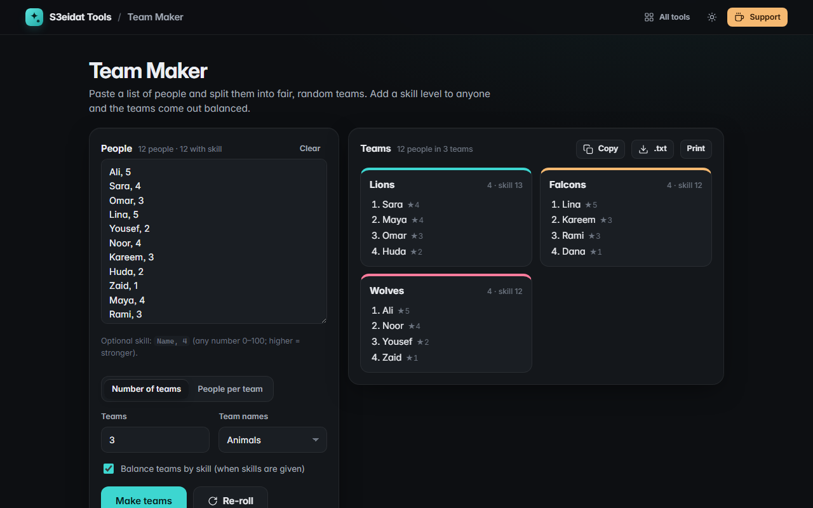

# Team Maker

> Split a list of people into fair, random teams. Free, private, and it runs entirely in your browser.

### ▶ [Open Team Maker](https://s3eidat.github.io/team-maker/)



## Features

- Paste names **one per line**; split by **number of teams** or **people per team** (team sizes never differ by more than one)
- **Balance by skill**: write <code>Name, 4</code> and the strongest players are spread across teams so team totals come out as even as possible
- **Fair shuffle**: Fisher-Yates driven by crypto.getRandomValues with rejection sampling
- Team names: numbers, letters, colours, animals or your own
- **Re-roll** in one click, **copy as text**, download a .txt, or **print** a clean sheet
- Your list and settings are remembered for next time

## Privacy

Your names are saved only in your browser (localStorage). There is no server, no account, no analytics.
The page ships with a strict Content-Security-Policy (`connect-src 'self'`), so the browser
itself blocks any attempt to send data anywhere.

## Run it yourself

It's plain HTML, CSS and JavaScript with no build step:

```bash
git clone https://github.com/s3eidat/team-maker
cd team-maker
python -m http.server 8000
```

Then open http://localhost:8000.

## Support

If this saved you time, **[buy me a coffee ☕](https://s3eidat.github.io/coffee/)**. It keeps every tool free.

---

Part of **[S3eidat Tools](https://s3eidat.github.io/)**: 100+ free, private tools that run in your browser. MIT licensed.
